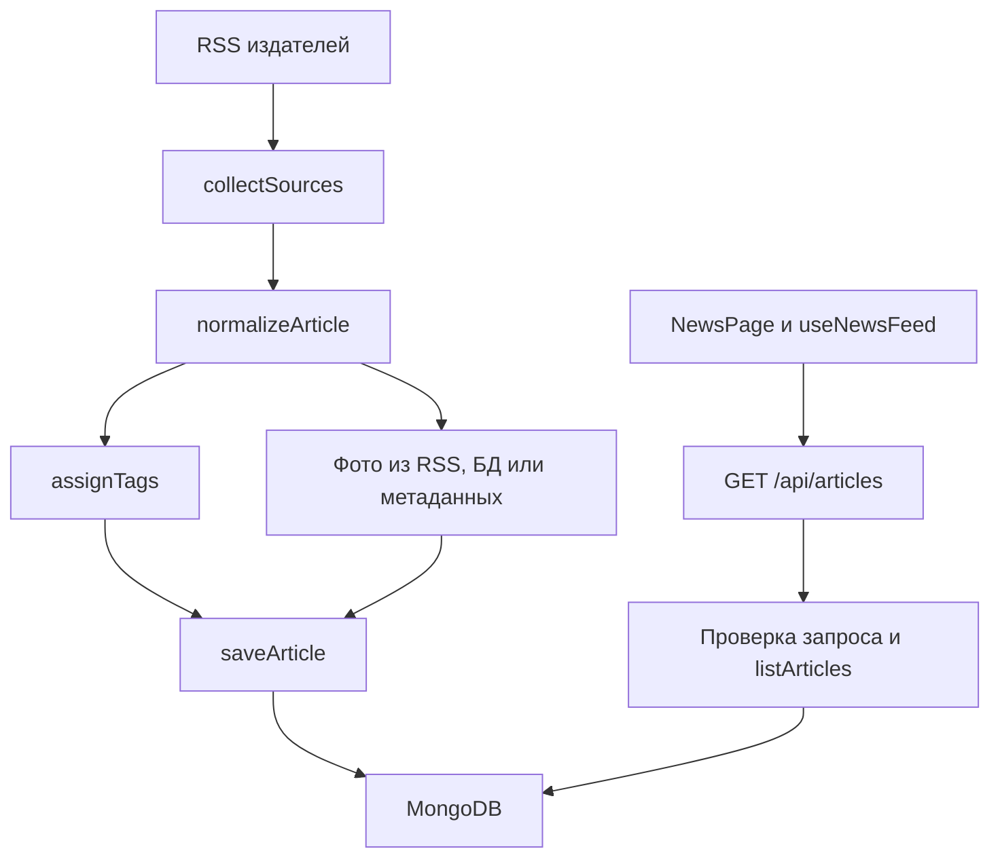

# Как объяснить The Bulgarian Brief на защите

## 1. Задача проекта

Приложение собирает заголовки из разрешённых болгарских RSS-источников, сохраняет метаданные в MongoDB и показывает общую ленту с поиском и фильтрами. Полную статью читатель открывает на сайте издателя. Темы определяются словарём ключевых слов, без ИИ.

Короткое вступление: «У проекта два процесса: Express API обслуживает читателей, а сборщик периодически обновляет базу. React получает данные через API. Благодаря MongoDB лента остаётся доступной, даже если сайт издателя временно не отвечает».

## 2. Как движутся данные



Сборщик и API используют одну базу и общий backend-пакет. Сборщик не вызывает HTTP API приложения. Браузер не обращается к MongoDB и не загружает RSS.

## 3. Backend: за что отвечает каждый модуль

Все пути ниже относительно `apps/api/src/`.

| Часть | Файлы | Ответственность |
| --- | --- | --- |
| Запуск HTTP | `server.ts`, `app.ts` | Подключение БД, запуск сервера, маршруты, защитные заголовки, раздача production frontend, завершение процесса |
| Конфигурация | `config.ts` | Проверка URI MongoDB и порта при запуске |
| Инфраструктура | `infrastructure/database.ts`, `infrastructure/http.ts` | Жизненный цикл БД; чтение сетевых ответов с ограничением 2 МБ |
| Источники | `modules/sources/` | Доверенные RSS URL, разрешённые хосты фотографий, публичный список, состояние сборов |
| Сетевые клиенты | `modules/ingestion/rss.client.ts`, `article-metadata.client.ts` | Получение RSS и метаданных страниц с таймаутами и проверками адресов |
| Нормализация | `modules/ingestion/article.normalizer.ts` | Проверка внешних данных, очистка текста и URL, выбор даты и допустимого превью |
| Оркестрация | `modules/ingestion/ingestion.service.ts` | Последовательность сбора: получить, нормализовать, дополнить, сохранить, записать результат |
| Темы | `modules/tagging/` | Словарь и сопоставление болгарских слов с темами; маршруты списка тем |
| Статьи | `modules/articles/` | Схема MongoDB, чтение сохранённых превью, сохранение, поиск, пагинация, обработка HTTP-запросов |
| Общие HTTP-ошибки | `middleware/error-handler.ts` | Единый JSON-формат ошибок без выдачи внутренних деталей |
| Фоновые задания | `jobs/` | Однократный сбор, расписание, email-оповещения и отдельное заполнение старых фотографий |

В модуле статей цепочка чтения такая: **route → validation → service → model**. Короткий обработчик в routes связывает HTTP с прикладным кодом. Validation проверяет недоверенные параметры. Service выполняет запрос. Model описывает поля и индексы MongoDB. Отдельный файл controller для одного короткого обработчика не нужен.

Сборщик использует articles service для чтения превью и сохранения статьи. Отдельный универсальный repository здесь не нужен: слой сервиса уже даёт понятную границу.

## 4. Что происходит при сборе

`collectSources` перебирает источники и объединяет результаты. `collectSource` обрабатывает один источник и возвращает число сохранённых/пропущенных записей и ошибку, если она была. Для частичных ошибок сохраняются только счётчик и первая причина, а не массив всех сообщений.

1. Источник берётся из конфигурации, а не из пользовательского ввода.
2. До сетевого запроса сохраняется время попытки.
3. RSS-клиент проверяет HTTPS, HTTP-статус, размер ответа и ограничения XML.
4. Нормализатор проверяет заголовок, ссылку и идентификатор. Некорректная запись пропускается.
5. Теги назначаются по нормализованному тексту с границами слов Unicode. Регулярные выражения подготовлены один раз при загрузке модуля.
6. Если допустимое фото уже есть в RSS, оно используется сразу. Иначе проверяется сохранённое превью, затем разрешённые метаданные страницы. Ошибка внешнего получения фото не должна мешать сохранению заголовка.
7. `saveArticle` делает upsert: обновляет существующую статью или вставляет новую.
8. Ошибка одной статьи не останавливает следующие записи. Если хотя бы одна статья завершилась ошибкой, источник помечается как неуспешный: предыдущий `lastSuccessAt` сохраняется, в отчёт попадают число ошибок и первая причина.
9. Остальные источники обрабатываются независимо. Успешный пустой RSS тоже считается успешной проверкой.

При остановке worker один `AbortSignal` передаётся через сборщик к RSS и метаданным страниц. Он объединяется с таймаутом каждого запроса. Отмена прерывает сетевое ожидание и обработку следующих записей, но не считается сбоем издателя. Уже начатая операция MongoDB завершается; сохранённые записи учитываются в отчёте.

В отчёте `processed` — число успешных сохранений, включая повторные обновления; это не число новых статей. `skipped` — отклонённые нормализатором записи. `failed` — ошибки источников, включая частичный сбой обработки статей.

## 5. Какие решения сохраняют корректность

- **Идентичность статьи:** уникальная пара `(sourceId, externalId)`. GUID берётся из RSS, а при его отсутствии используется очищенный URL. Одна новость у двух издателей остаётся двумя статьями.
- **Стабильная дата:** `publishedAt` и `firstSeenAt` задаются при первой вставке. Повторный сбор их не сдвигает. Некорректная дата, дата из будущего или распознаваемая дата без часового пояса заменяется временем первого сбора. Ранее сохранённые ошибочные даты автоматически не переписываются.
- **Пагинация:** сортировка по `publishedAt`, затем `_id`, в убывающем порядке. Курсор содержит оба значения, поэтому статьи с одинаковой датой не теряются между страницами. Курсор проверяется перед запросом в БД.
- **Поиск:** строка поиска экранируется и используется как буквальный текст, а не пользовательское регулярное выражение. Сейчас это поиск подстроки без отдельного поискового индекса.
- **Превью:** разрешённые HTTPS-хосты проверяются при обработке и выдаче данных. Правила издателей собраны в `sources.config.ts`: `previewPolicy` задаёт длину анонса, обязательную атрибуцию, использование только RSS-фото и подпись вместо изображения. API передаёт подпись в `imageLabel`, поэтому карточке не нужны проверки идентификаторов издателей.

## 6. Frontend: данные отдельно от отображения

Все пути ниже относительно `apps/web/src/features/news/`.

| Файл | Что объяснять |
| --- | --- |
| `news.api.ts` | Типы ответов и HTTP-запросы; преобразование фильтров в query parameters |
| `useNewsFeed.ts` | React hook: статьи, первая и следующие страницы, загрузка, ошибки, отмена запросов |
| `NewsPage.tsx` | Компоновка страницы, выбранные фильтры, загрузка списков источников и тем, кнопки обновления |
| `NewsFilters.tsx` | Форма поиска и выбор источника/темы; передача новых фильтров странице |
| `NewsCard.tsx` | Одна статья: заголовок, автор, анонс, дата, темы, фото или запасной вид |
| `NewStoriesNotice.tsx` | Проверка новых статей каждую минуту; обновление только по решению читателя |

Hook — обычная функция React, которая объединяет связанную логику состояния и эффектов. Здесь он выделен для разделения сетевой логики и JSX, а не ради повторного использования.

При смене фильтра, обновлении или уходе со страницы старый запрос отменяется. Даже если ответ всё-таки пришёл, проверка `signal.aborted` не даёт ему изменить новую ленту. Следующие страницы дописываются с исключением уже загруженных ID. Ошибка пагинации сохраняет прочитанные статьи и позволяет повторить запрос.

Повтор загрузки списков источников/тем и обновление новостей имеют независимые ключи состояния. Поэтому `Retry filters` не сбрасывает прочитанные страницы, а `Refresh news` не делает лишние запросы справочников.

## 7. Проверки и демонстрация

Из корня проекта:

```sh
npm run db:up
npm test
npm run typecheck
npm run build
```

Интеграционные тесты требуют работающей MongoDB. Общий helper в `apps/api/test/helpers/test-database.ts` до подключения разрешает только базы `bulgarian_news_test` и `bulgarian_news_alerts_test` и явно закрепляет выбранное имя. Даже эти базы должны содержать только тестовые данные: подготовка тестов удаляет записи.

Тесты проверяют нормализацию, безопасность ссылок, теги, сохранение и пагинацию, ошибки отдельных статей и источников, оповещения, отмену устаревших запросов и поведение интерфейса. Для сетевых издателей используются локальные ответы; настоящие письма не отправляются. Unit-тесты оркестрации подменяют только границу MongoDB, интеграционные тесты работают с реальной базой.

На демонстрации удобно показать: исходную ленту, фильтр темы, поиск, следующую страницу, переход к оригиналу. Затем открыть `collectSources`, `saveArticle` и `useNewsFeed` и объяснить их роли по таблицам выше.

## 8. Что честно назвать ограничениями

Теги не понимают смысл и не перечисленные в словаре формы слов. RSS не является полным архивом. Поиск по мере роста истории может потребовать индекса. Метаданные фотографий получаются последовательно и могут задерживать сбор. Ошибки отдельных статей повторяются при следующем сборе, пока статья остаётся в RSS. `/api/health` проверяет подключение к БД, но не свежесть новостей.

Для учебного проекта выбран модульный монолит: модули разделяют ответственность, но не требуют очереди сообщений, отдельных микросервисов и сложного управления состоянием frontend. Усложнять эту структуру стоит при конкретной измеренной проблеме.
